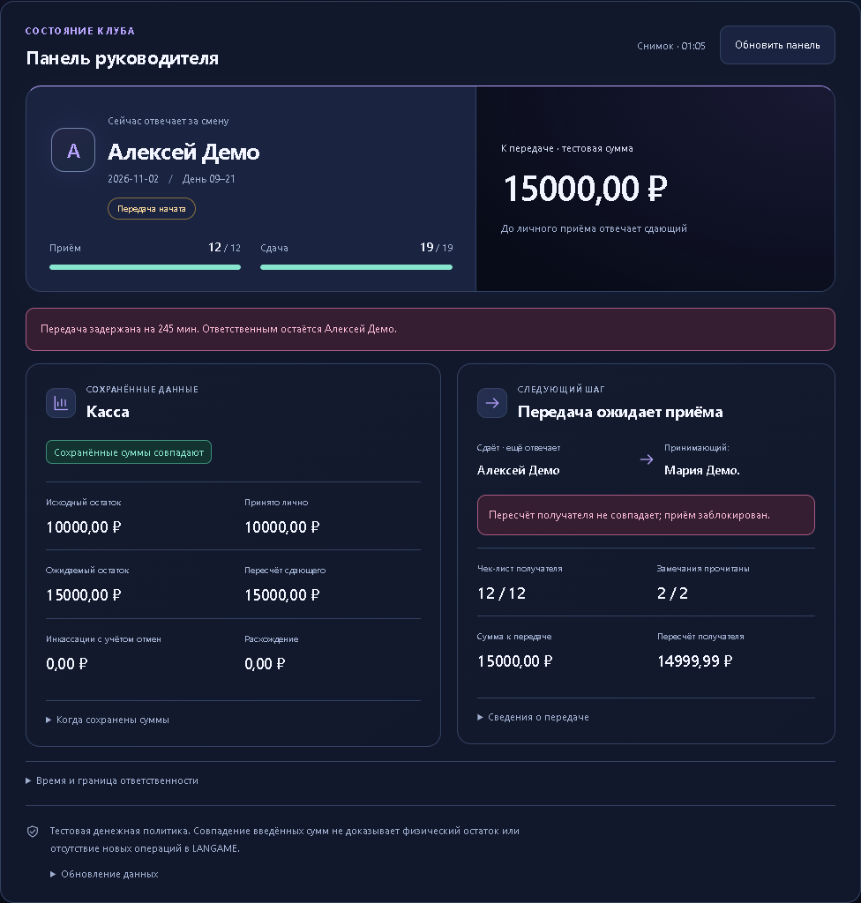
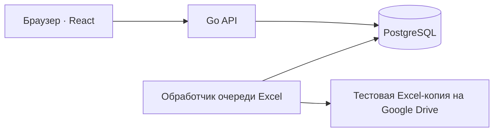

# PC Club Admin

Передача смен между сотрудниками компьютерного клуба: чек-листы, замечания и личное подтверждение принимающего. Пока второй сотрудник не завершил проверку и пересчёт, ответственность остаётся у сдающего. Управляющий видит результат в панели, истории и журнале действий.

[Видео · 1 мин 27 с](assets/demo/walkthrough.webm) · [Скриншоты, сценарий и запуск](docs/demo.md) · [CI](https://github.com/eclipse-vlr/pc-club-admin/actions/workflows/ci.yml)



**Важно:** это пока тестовая версия. Для настоящего учёта денег её ещё нельзя использовать — ниже описано, что осталось проверить перед запуском.

## Что уже работает

- Тёмный игровой интерфейс и светлая тема; анимации переходов, прогресса и сохранения с отдельным выключателем и поддержкой reduced-motion.
- Управление сотрудниками: назначение ролей при создании, изменение имени, отключение и сброс PIN.
- Личный вход администратора по PIN с зарегистрированного клубного браузера; отдельный вход управляющего по паролю.
- Создание первой смены и её личный приём после чек-листа и пересчёта наличных.
- Тестовая передача между двумя сотрудниками: отдельные PIN-входы, пересчёт получателя, ознакомление с замечаниями и отзыв передачи.
- 12 пунктов приёма и 19 пунктов сдачи с сохранением ответов и указанием незавершённых проверок.
- Защита от повторной отправки форм, предупреждения о несохранённой кассе и сохранение её черновика при работе с чек-листом.
- Заметки о неисправностях и конфликтах.
- Автоматическое заполнение чек-листа в Excel на Google Drive: запись и повтор без дубликатов проверены на тестовой копии.
- Тестовая сверка кассы, журнал инкассаций и их отмен с сохранением истории.
- Разделение прав сотрудников, журнал действий и защита от повторной записи денежных операций.
- История смен с фильтрами и просмотром чек-листов, кассы и снимков передач.
- Создание резервной копии и проверка восстановления в изолированной тестовой базе.
- CSV-выгрузки смен и сохранённых кассовых данных за выбранный период.
- Журнал действий для управляющего: авторы, результаты, фильтры и безопасный просмотр изменений «до/после».
- Панель руководителя: текущий ответственный, задержка передачи, принимающий и сохранённые кассовые данные.
- Запуск отдельной тестовой версии из готового Docker-образа без установки Go и Node.js.

## Демонстрация

Отдельный локальный контур с вымышленным демоклубом «Орион», управляющим и двумя администраторами. Нужны Git, Node.js 24 и запущенный Docker Desktop с Linux-контейнерами. Из корня репозитория:

```powershell
node scripts/portfolio-demo.mjs up
```

Откройте `http://127.0.0.1:18081`. Управляющий: `demo-manager`, пароль: `portfolio-demo-only-2026`. Это общедоступные данные **только локального демо**. Сотрудники входят по PIN после обычной регистрации браузера управляющим. [Полная инструкция](docs/demo.md) объясняет вход, тестовые суммы и явный сброс. Google Drive отключён.

Скриншоты и [видео без звука](assets/demo/walkthrough.webm) сняты в настоящем приложении с PostgreSQL. В видео есть подписи этапов и паузы после действий: замечания, подготовка, блокировка расхождения, личный приём и история. Публичного демостенда пока нет. Результат автоматических проверок выбранного коммита доступен в [CI](https://github.com/eclipse-vlr/pc-club-admin/actions/workflows/ci.yml).

## Техническое решение

Стек: Go, PostgreSQL, React, TypeScript, Docker Compose. Приложение состоит из API и интерфейса; отдельный обработчик доставляет сохранённые чек-листы в Excel при включённой тестовой интеграции.



Приём передачи проверяет версию снимка, заполненный чек-лист, ознакомление с замечаниями, пересчёт и повторный личный PIN. В одной транзакции PostgreSQL закрывается предыдущая смена и начинается следующая с общей границей времени. Ключ идемпотентности позволяет восстановить результат повторного запроса; устаревшая версия отклоняется.

Пример обработанного сбоя: сервер сохранил передачу, а браузер потерял ответ. Интерфейс блокирует повторное подтверждение до проверки сессии и перечитывания состояния. Этот случай проверяется браузерными и интеграционными тестами; при демонстрации также проверяется блокировка расхождения в одну копейку. [Проверки и их ограничения](docs/demo.md#проверки).

## Основные правила

Дневная смена — с 09:00 до 21:00, ночная — с 21:00 до 09:00. У смены один ответственный сотрудник; наступление времени окончания само по себе не снимает ответственность.

Пустой ответ и обычное «Нет» блокируют завершение чек-листа. Исключение — отсутствие конфликтных ситуаций. Обнаруженную поломку нужно описать; завершать ремонт до передачи не требуется. Управляющий не может подтвердить действия за администратора или обойти обязательные проверки.

Расхождение наличных блокирует приём или передачу. Переносимый остаток хранится в нашей системе, данные LANGAME вводятся вручную за текущую смену. Инкассации учитываются отдельно.

## Что осталось до запуска

Подготовлена серверная поставка с HTTPS. До запуска нужны проверка на клубном ПК, настройка ежедневного резервирования с защищённым хранением и реальная кассовая сверка. Запись в тестовую копию Excel проверена на личном ПК; установка в клубе ещё не проводилась.

**Денежный расчёт предварительный.** Сейчас разрешены только вымышленные тестовые данные. Перед реальной работой необходимо проверить расчёт на сменах клуба, согласовать правила учёта и провести пилот параллельно с действующим учётом. До этого рабочий режим заблокирован.
