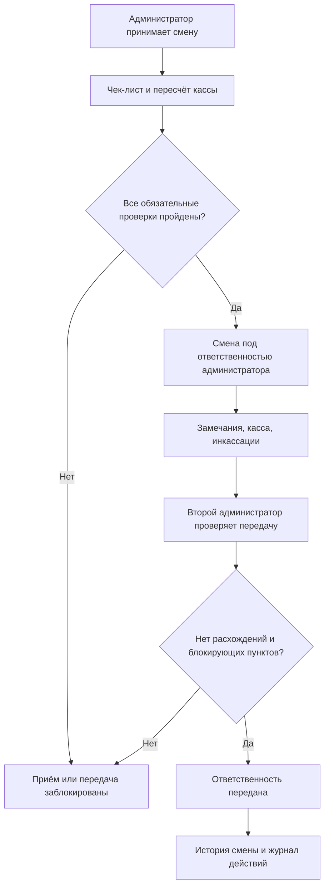

# Демонстрация PC Club Admin

Это описание сценариев **тестовой версии** для знакомства с системой. Настоящие деньги, PIN-коды сотрудников и рабочие данные клуба использовать нельзя. Публичный демостенд и скриншоты пока не опубликованы.

## Что показывает проект

PC Club Admin помогает двум сотрудникам передавать ответственность за смену без потери информации о кассе, проверках и замечаниях. Управляющий отдельно видит историю действий и состояние смен.

## Сценарий для демонстрации

1. **Подготовить тестовый клуб.** В тестовой среде управляющий заводит двух вымышленных сотрудников и назначает им роли.
2. **Открыть смену.** Первый администратор входит со своим PIN на зарегистрированном клубном браузере, проходит чек-лист и заносит вымышленный остаток наличных.
3. **Записать замечание.** Создать тестовое сообщение о неисправности. Эта запись должна быть доступна следующему администратору.
4. **Передать смену.** Второй администратор входит под своим PIN, знакомится с замечаниями, повторно пересчитывает тестовую кассу и принимает ответственность.
5. **Проверить ограничения.** Повторить сценарий, намеренно указав разные суммы. При расхождении передача должна блокироваться. Незакрытые обязательные пункты чек-листа тоже блокируют передачу.
6. **Посмотреть историю.** Войти как управляющий и проверить историю смен, журнал действий, данные кассы и доступные CSV-выгрузки.

Данные LANGAME за текущую смену вводятся вручную. Инкассации учитываются отдельно, а отсутствие конфликтных ситуаций — особый случай ответа «Нет» в чек-листе, который не блокирует передачу.

## Упрощённая схема

## Что можно показать на скриншотах

После запуска тестовой версии имеет смысл добавить четыре **реальных** снимка экрана: панель управляющего, чек-лист, экран передачи смены и историю действий. Сначала нужно удалить или заменить все персональные и финансовые данные. Пока этих файлов в документацию не добавляли.

## Ограничения

Это демонстрация текущей логики, а не подтверждение готовности к эксплуатации. Учёт реальных денег и использование на клубном ПК требуют отдельной проверки и пилотного запуска. Актуальные ограничения описаны в [основном README](../README.md).
