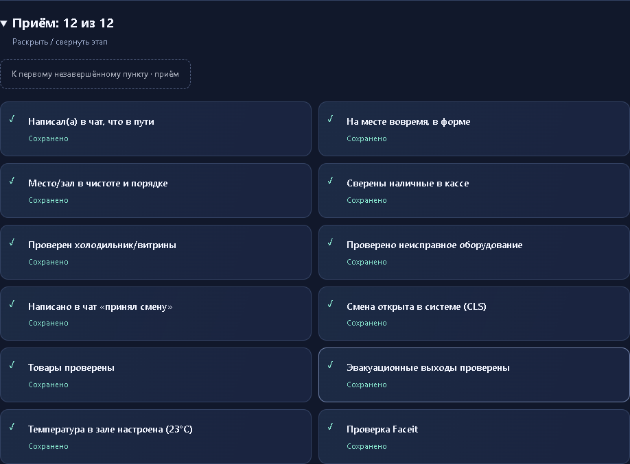
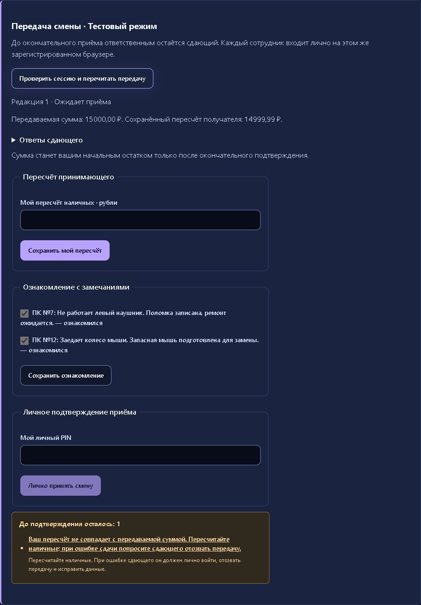
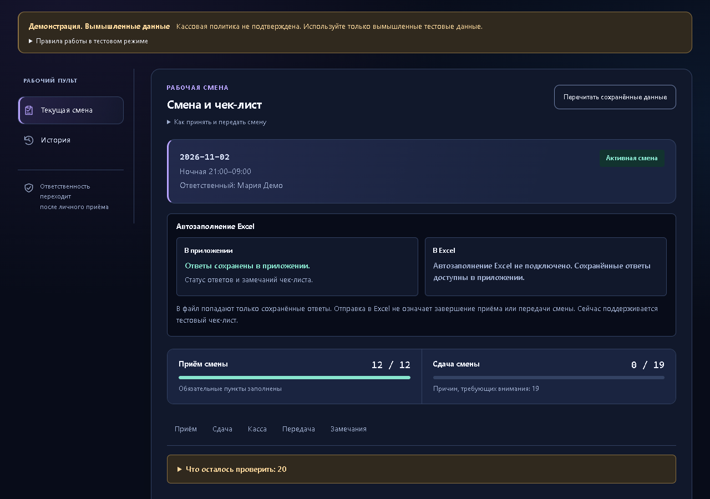
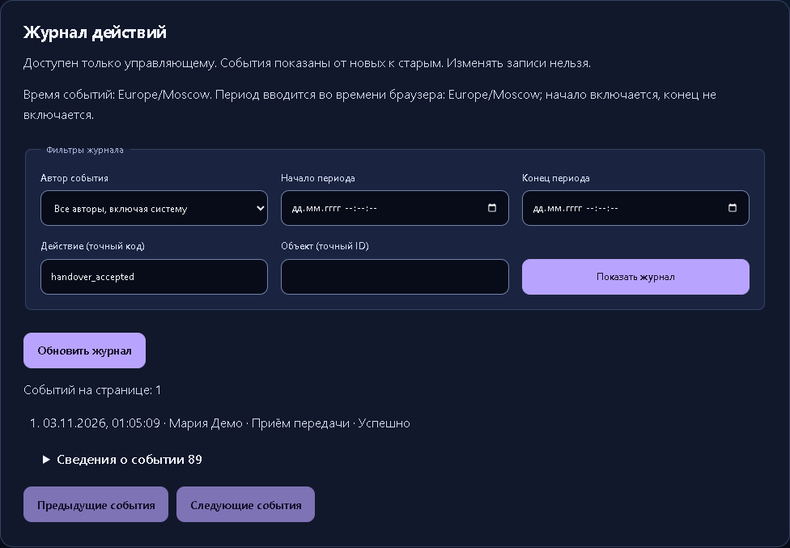

# Демонстрация PC Club Admin

Вымышленный демоклуб «Орион»: Алексей сдаёт смену Марии, Мария проверяет замечания и наличные, управляющий видит результат. Это тестовая версия: использовать настоящие деньги и данные клуба нельзя. Публичного стенда нет; локальный запуск доступен без Google Drive.

[Основной README](../README.md)

[Видео демонстрации · 1 мин 27 с](../assets/demo/walkthrough.webm) — без звука,
с подписями и паузами. Алексей подготовил чек-листы; в записи видны замечания,
кассовый черновик, личный вход Марии, блокировка расхождения в одну копейку,
успешный приём, история и журнал. Подготовка начального окружения показана в инструкции ниже.

## Первый запуск

Нужны Git, Node.js 24 и Docker Desktop с Linux-контейнерами. Из корня клонированного репозитория:

```powershell
node scripts/portfolio-demo.mjs up
```

Команда собирает исходники, запускает отдельную PostgreSQL, выполняет миграции, создаёт управляющего и двух администраторов через штатные средства приложения. Готовится дневная смена 2 ноября 2026 года с остатком 10 000 ₽; лично принять её должен Алексей. БД вручную редактировать не нужно. В первый раз Docker скачивает образы и зависимости; дождитесь сообщения с адресом.

| Назначение | Значение |
| --- | --- |
| Адрес | `http://127.0.0.1:18081` |
| Docker-проект | `pc-club-portfolio-demo` |
| БД | `pcclub_staging` в отдельном контейнере проекта |
| Том | `pc-club-portfolio-demo_staging_postgres_data` |
| Конфигурация | `deploy/.portfolio-demo/.env`, вне Git |
| Управляющий | `demo-manager` / `portfolio-demo-only-2026` |
| Алексей Демо | PIN `123456` |
| Мария Демо | PIN `654321` |

Эти учётные данные намеренно опубликованы для локальной демонстрации. Порт доступен только с этого компьютера. Не публикуйте данный контур в интернете: самостоятельный внешний доступ требует отдельной изоляции пользователей и настройки защиты.

Секреты БД генерируются один раз; повторный запуск сохраняет исходный `PIN_PEPPER`. Конфигурации staging, существующая установка клуба и её секреты не читаются. Excel-синхронизация выключена; денежная политика остаётся `unverified`.

### Регистрация браузера

1. На странице входа выберите «Управляющий · пароль», введите данные из таблицы.
2. В разделе доверенных браузеров повторите пароль и нажмите «Создать код на 10 минут».
3. Скопируйте код, выйдите из приложения. В том же браузере откройте «Зарегистрировать браузер клуба».
4. Вставьте код и назовите браузер «Демоклуб Орион». Нажмите «Зарегистрировать».
5. Появится выбор сотрудников для входа по PIN. Регистрация сохраняется в cookie; после их очистки нужен новый код.

## Прохождение сценария

1. Войдите как **Алексей Демо**. Первый приём пока заблокирован. В «Приём» сохраните ответы «Да» на все 12 пунктов. Введите пересчёт `10000` и личный PIN `123456`, подтвердите первый приём.
2. Раскройте «Сдача». Сохраните ответы «Да» на 19 пунктов; у пункта конфликтов выберите «Нет конфликтов». Для демонстрации поломки можно отметить неисправность у «Неисправности устранены/зафиксированы» и создать связанную заметку.
3. В «Замечания» выберите пункт «Неисправности устранены/зафиксированы», категорию «Неисправность», объект «ПК №7». Текст: «Не работает левый наушник. Поломка записана, ремонт ожидается». Сохраните замечание. Аналогично добавьте «ПК №12»: «Заедает колесо мыши. Запасная мышь подготовлена для замены». Ремонт до передачи не требуется.
4. В кассовом черновике введите изменение наличных LANGAME `5000`, дополнительные возвраты `0`, расходы `0`, пересчёт после изъятий `15000`. Сохраните кассовый черновик. Это вымышленные суммы, инкассаций в сценарии нет.
5. В «Передача» выберите **Марию Демо**, введите PIN Алексея `123456`, нажмите «Подготовить передачу и выйти». Сессия Алексея завершится; он остаётся ответственным до личного приёма Марией.
6. Мария входит отдельно с PIN `654321`. В её «Приём» сохраните 12 ответов «Да». В передаче отметьте замечания и сохраните ознакомление.
7. Сохраните пересчёт `14999,99`. Появится причина блокировки; «Лично принять смену» недоступно из-за одной копейки расхождения.
8. Исправьте пересчёт на `15000`, сохраните его, введите PIN Марии `654321` и лично примите смену. Появится активная ночная смена Марии с начальным остатком 15 000 ₽; статус передачи «Принята» виден в истории.
9. Выйдите, войдите как управляющий. Панель должна показывать Марию ответственной. В «История смен» откройте закрытую смену Алексея и снимок принятой передачи. В журнале выберите действие `handover_accepted`: одна успешная запись.






## Повторный запуск и сброс

```powershell
node scripts/portfolio-demo.mjs status
node scripts/portfolio-demo.mjs stop
node scripts/portfolio-demo.mjs up
```

`stop` сохраняет БД. `up` повторяет миграции и восстанавливает отсутствующие демоданные после частичной подготовки; существующую смену и её ответы не меняет.

Чтобы начать сценарий заново, явно выберите демонстрацию:

```powershell
node scripts/portfolio-demo.mjs reset --environment portfolio-demo
node scripts/portfolio-demo.mjs up
```

Сброс удаляет только контейнеры и том этого проекта после проверки меток принадлежности. Файл секретов сохраняется. Сессии и регистрация браузеров из удалённой БД перестают действовать: обновите страницу и повторите регистрацию по инструкции выше. Вручную удалять `.env` или менять pepper не нужно.

Параллельные команды защищены файлом `operation.lock`. Если процесс был аварийно завершён, сначала убедитесь, что другой запуск действительно не работает, и разберите оставшийся lock; скрипт не удаляет его автоматически.

## Обновление скриншотов

После `reset` и `up`, до ручного прохождения сценария:

```powershell
npm ci --prefix web
$env:PC_CLUB_CHROMIUM = 'C:\Program Files\Google\Chrome\Application\chrome.exe'
node web/e2e/portfolio-demo.mjs
```

Используется установленный Chrome; другой Chromium можно указать в `PC_CLUB_CHROMIUM`. Сценарий регистрирует браузер штатным одноразовым кодом и проходит приём и передачу через интерфейс. Он сохраняет шесть реальных PNG в `assets/demo`, а отчёт — в `output/playwright/portfolio-demo/verification.json`. Самостоятельно удалять БД браузерный сценарий не умеет. Перед публикацией просмотрите материалы. Каталог `output` исключён из Git и Docker-контекста.

Для новой записи сначала отдельно выполните `reset` и `up`, затем:

```powershell
node web/e2e/portfolio-demo.mjs --record
Copy-Item output/playwright/portfolio-demo/walkthrough.webm assets/demo/walkthrough.webm
```

Начальная смена подготавливается через настоящий интерфейс до начала записи.
Запись начинается с действий сдающего, после которых принимающий проходит свой
чек-лист. После сохранения каждого его пункта выдерживается пауза не менее секунды;
результаты ключевых этапов остаются на экране дольше. Подписи добавляются только
в записываемую страницу и не входят в приложение. Исходник и отчёт `recording.json`
остаются в `output`; в публичный набор копируется только проверенное видео.

## Проверки

В шапке доступны переключатели темы и анимаций. Анимации не задерживают подтверждения и не меняют введённые данные. Системный reduced-motion отключает движение; выключатель также сохраняет выбор между открытиями страницы. Проверка `web/e2e/motion.mjs` покрывает прерывание переходов, сохранение выбора, ограниченное хранилище браузера и узкий экран.

Проверка демонстрации работает с настоящими Go API и PostgreSQL: пропущенный чек-лист, отдельные входы сотрудников, замечание, несовпадение на копейку, исправление, окончательный приём, панель, история и единственная запись `handover_accepted` в журнале. Это не проверка реального денежного учёта.

`node --test scripts/test-portfolio-demo.mjs` проверяет ограничения сброса, конфигурации, владения томом и повторяемой подготовки. CI запускает эти проверки; сценарий полной записи выполняется отдельно, поскольку ему нужны запущенное изолированное демо и Chromium.

Существующие браузерные проверки с подменой API покрывают потерю ответа, черновики, смену сессии, устаревшие данные и ошибки соединения. Они не подтверждают работу БД. PostgreSQL-интеграционные тесты отдельно проверяют транзакции, идемпотентность и границу ответственности. Конкретный результат CI следует смотреть для выбранного коммита.

## Ограничения и следующий шаг

### Разбор: передача сохранилась, но браузер потерял ответ

Задача — передать ответственность конкретному сотруднику, оставив проверяемую
историю. Нажатие «Подготовить передачу и выйти» сохраняет снимок и отзывает сессию
сдающего; до личного приёма ответственность остаётся у него. Если HTTP-ответ
потерялся после сохранения, повторное нажатие не должно создавать ещё одну передачу.

Защита состоит из нескольких частей: сервер хранит результат команды по
`Idempotency-Key`, проверяет версии и блокирует строки внутри транзакции.
Браузер при неизвестном результате предлагает проверить вход и перечитать состояние.
В окончательном приёме проверяются чек-листы, замечания, пересчёт и личный PIN;
закрытие старой и начало новой смены имеют одну временную границу.

Проверяемые примеры опубликованной базовой версии:
[сервис передачи](https://github.com/eclipse-vlr/pc-club-admin/blob/052a616f4b51e50343ab5dad9968468b1dada45e/internal/shifts/handover.go),
[транзакция приёма](https://github.com/eclipse-vlr/pc-club-admin/blob/052a616f4b51e50343ab5dad9968468b1dada45e/internal/storage/postgres/handovers.go#L97),
[потеря ответа в браузере](https://github.com/eclipse-vlr/pc-club-admin/blob/052a616f4b51e50343ab5dad9968468b1dada45e/web/e2e/handover.mjs),
[интеграционная проверка двух личных входов и единственной записи аудита](https://github.com/eclipse-vlr/pc-club-admin/blob/052a616f4b51e50343ab5dad9968468b1dada45e/internal/httpapi/handover_integration_test.go#L23).
Новая локальная демонстрация также показывает расхождение в одну копейку,
исправление и одного нового ответственного. Это проверки тестового процесса;
они не заменяют согласование денежной политики и пилот клуба.

Материалы записаны на основе `052a616f4b51e50343ab5dad9968468b1dada45e` с изменениями демонстрации и интерфейса. Версия и состояние рабочего дерева при записи сохраняются в локальном отчёте. Запись не заменяет автоматические проверки: результат текущей версии смотрите в [CI](https://github.com/eclipse-vlr/pc-club-admin/actions/workflows/ci.yml).

Для эксплуатации остаются проверка на клубном ПК, согласование денежной политики, защищённые ежедневные резервные копии с восстановлением и параллельный пилот. Этот демоконтур их не заменяет. Наличие очереди Excel не подтверждает связь с рабочим Google Drive: интеграция в этом показе отключена.
